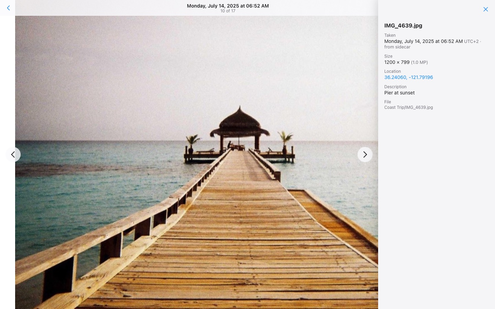
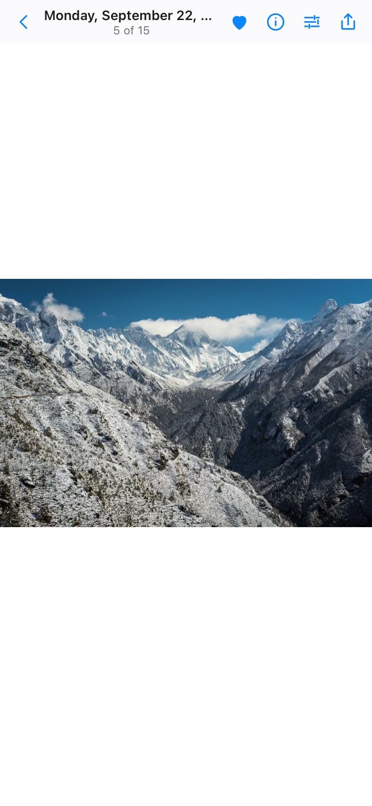
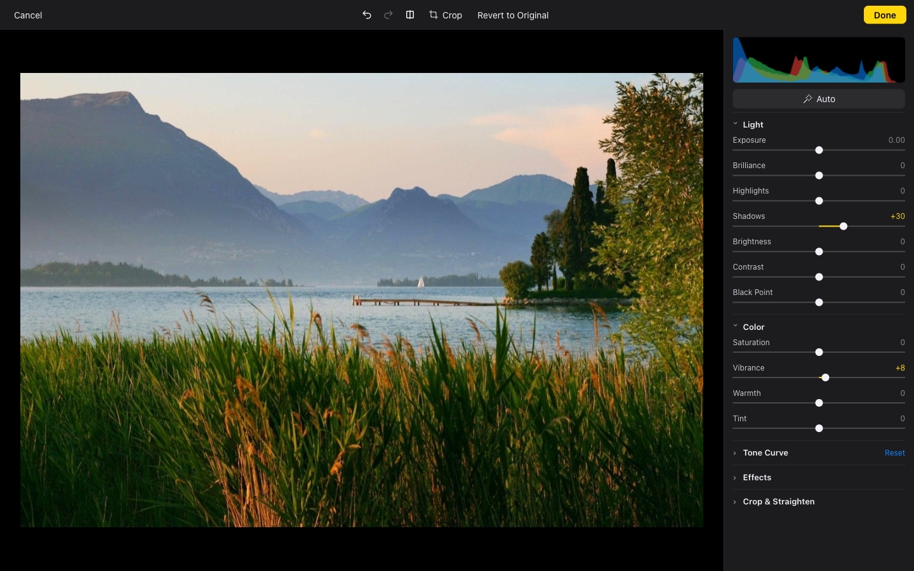
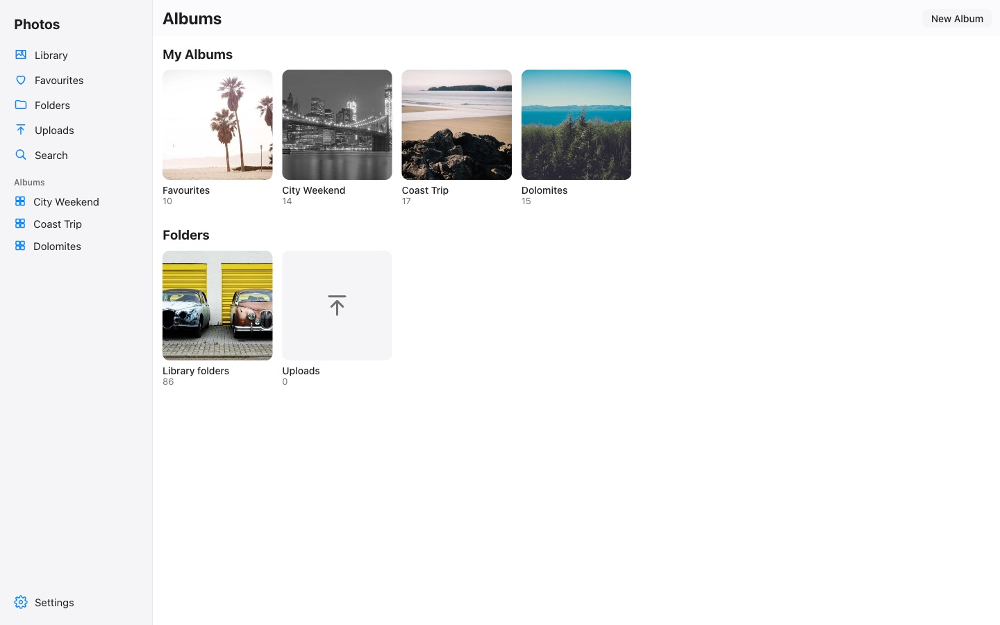
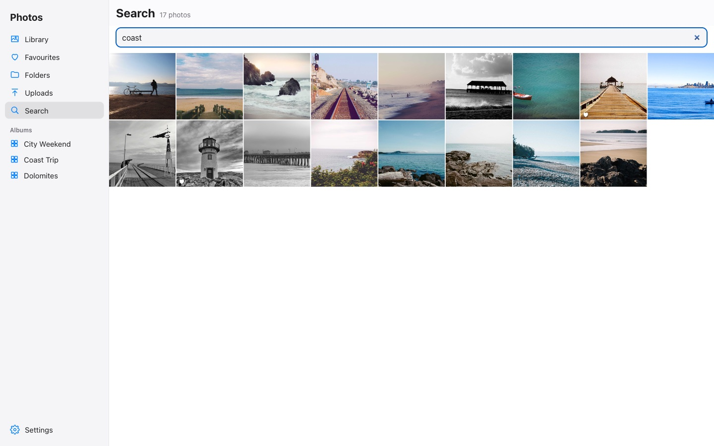
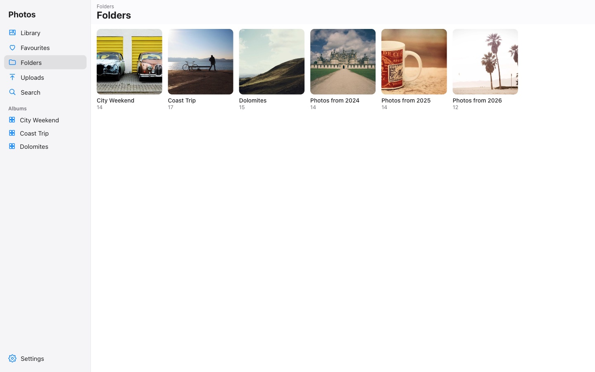

# Web Photo Library

A self-hosted, Apple Photos–style photo library. A Mac serves a **read-only** folder of
images (including Google Photos Takeout exports) to a web app that works on desktop and as an
iPhone Home Screen app, reached privately over [Tailscale](https://tailscale.com).

> Status: **milestone 4 of 6** — indexing, timeline, folders, viewer, albums, favourites,
> search, uploads, installable app, offline mode, non-destructive editing. Faces and places are
> designed ([spec](docs/superpowers/specs/2026-11-25-photo-server-design.md)) and on the way.

## Screenshots

| Desktop | iPhone |
|---|---|
|  |  |
|  |  |
|  |  |
|  |  |
|  |  |
|  |  |
|  | |
|  | |

Screenshots use the stock-photo demo library in [`demo/`](demo/) ([credits](docs/screenshots/CREDITS.md));
regenerate them with `demo/take-screenshots.sh`.

## What it does today

- **Read-only library.** Point it at any folder on the Mac; it never writes there. Thumbnails,
  previews and the database live in a separate, movable data location.
- **Google Takeout aware.** Dates, locations, descriptions and favourites come from Takeout JSON
  sidecars (with all their naming quirks), then EXIF, then the file date. Duplicate copies that
  Takeout scatters across album folders are recognised by content hash and shown once.
- **Fast.** HEIC thumbnails and previews via the Mac's hardware HEVC codec, one decode per photo,
  8 parallel workers (~16 s for 550 photos on an M-series Mac). BlurHash placeholders while loading.
- **Photos-like UI.** Month-grouped timeline (local time where each photo was taken), pinch or
  ⌘-scroll to change density, folders with covers, a full-screen viewer with swipe, swipe-down to
  close, pinch/double-tap zoom, info panel and original download.
- **Albums and favourites.** Create albums from a multi-selection (Select button, long-press on
  iPhone, ⌘/shift-click on desktop), reorder-safe membership by content hash, ♥ in the viewer
  (or press F). Google Takeout album folders become albums with one click.
- **Search** across file names, folders, descriptions and album titles.
- **Uploads.** Upload from the iPhone photo picker or drag files/folders onto the desktop window.
  Uploads go to a separate uploads folder (`phone-uploads/`, `desktop-uploads/`), are de-duplicated
  by content hash, and keep their albums and favourites if you later move them into the library.
- **Works offline.** The catalog is kept on the device and updated with small deltas; photos you
  look at are cached (size limit and Clear in Settings → This device). **Download** an album from
  its ⋯ menu to keep its thumbnails and previews; offline the app opens without a network and is
  view-only.
- **Non-destructive editor.** Light (exposure, brilliance, highlights, shadows, brightness,
  contrast, black point), colour (saturation, vibrance, warmth, tint), tone curve, sharpness,
  vignette, crop with aspect presets, straighten, rotate, flip, Auto, undo/redo, hold to compare,
  full history and Revert to Original. Photos-style on the iPhone, Lightroom-style panels with a
  histogram on desktop. The preview is exactly what gets saved: one shader file
  (`shaders/edit.wgsl`) runs in the browser (WebGPU) and on the Mac (Metal, via naga). Edited
  thumbnails/previews are rendered on the Mac, so viewing never needs WebGPU; **Export** renders
  the edit at full resolution (JPEG/HEIC, original metadata kept) for the share sheet or a download.
- **Installable** to the iPhone Home Screen (Share → Add to Home Screen) or the Dock / app list.
- **Everything configured in the browser:** library folder (server-side folder picker), refresh
  jobs (Detect changes, Re-index, Rebuild caches, Purge missing), data location with “Move…”.
- **Versioned API.** Every response carries the API version; if the app and server don't match,
  the app asks you to update (a reload — the server serves the app).

## Requirements

- A Mac with Apple Silicon (macOS 15+), Swift 6 (Xcode or Command Line Tools), Node 20+.
- For editing: a browser with WebGPU (Safari on iOS / macOS 26, current Chrome).
- Tailscale on the Mac and your devices for remote access.

## Run it

```sh
# build the web app
cd web && npm install && npm run build && cd ..

# build and start the server (serves web/build, listens on 127.0.0.1:8787)
cd server && swift build -c release && .build/release/PhotoServer
```

Open <http://127.0.0.1:8787>, choose your library folder in **Settings**, and it starts indexing.
If the folder is in Documents, Desktop or on an external drive, give the server binary (or your
terminal) **Full Disk Access** in System Settings → Privacy & Security.

### From your iPhone (Tailscale)

The server only listens on localhost; Tailscale publishes it inside your tailnet over HTTPS
(needed for the Home Screen app):

```sh
tailscale serve --bg 8787
```

Then open `https://<your-mac>.<your-tailnet>.ts.net` on the phone and use Share → **Add to Home
Screen**. Optionally set your Tailscale login under Settings → Access so only you get in.

## Develop

```sh
scripts/test-server.sh        # server tests (Swift Testing)
demo/take-screenshots.sh      # README screenshots from the demo library (after a release build)
cd web && npm test            # web unit tests
cd web && npm run dev         # Vite dev server, proxies /api to 127.0.0.1:8787
PHOTOSERVER_HOME=/tmp/ps2 PORT=8799 WEB_ROOT=/tmp/web2 server/.build/release/PhotoServer   # second instance
WEB_OUT=/tmp/web2 npm run build   # (in web/) a test build that doesn't replace what the running server serves
scripts/gen-shaders.sh        # after editing shaders/edit.wgsl: regenerate the server's Metal code (needs naga)
```

**Edit pipeline parity.** `shaders/edit.wgsl` is the only implementation of the edit maths.
`scripts/gen-shaders.sh` (`cargo install naga-cli`) translates it to Metal into
`server/Sources/PhotoCore/Editing/EditShaders.generated.swift` (committed, so building the server
needs no naga; a test fails if it is stale). Both sides render `shaders/fixtures` recipes and
compare against the same golden images (server: Metal; web: Dawn via the `webgpu` npm package),
within 1/255 per channel. After an intended shader change:
`UPDATE_GOLDENS=1 scripts/test-server.sh --filter EditRender`.

Layout: `server/` (Swift package — `PhotoCore` indexing/DB, `PhotoAPI` HTTP routes, `PhotoServer`
executable), `web/` (SvelteKit single-page app), `docs/` (design spec and plans).
