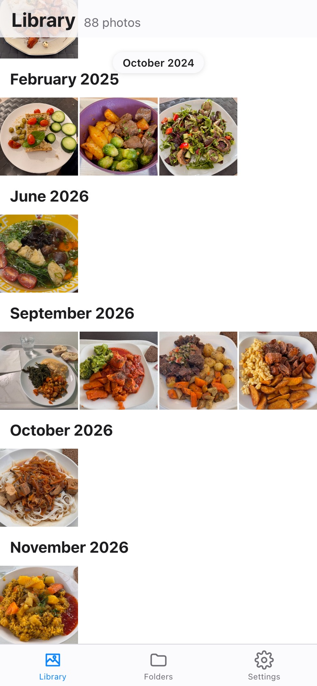
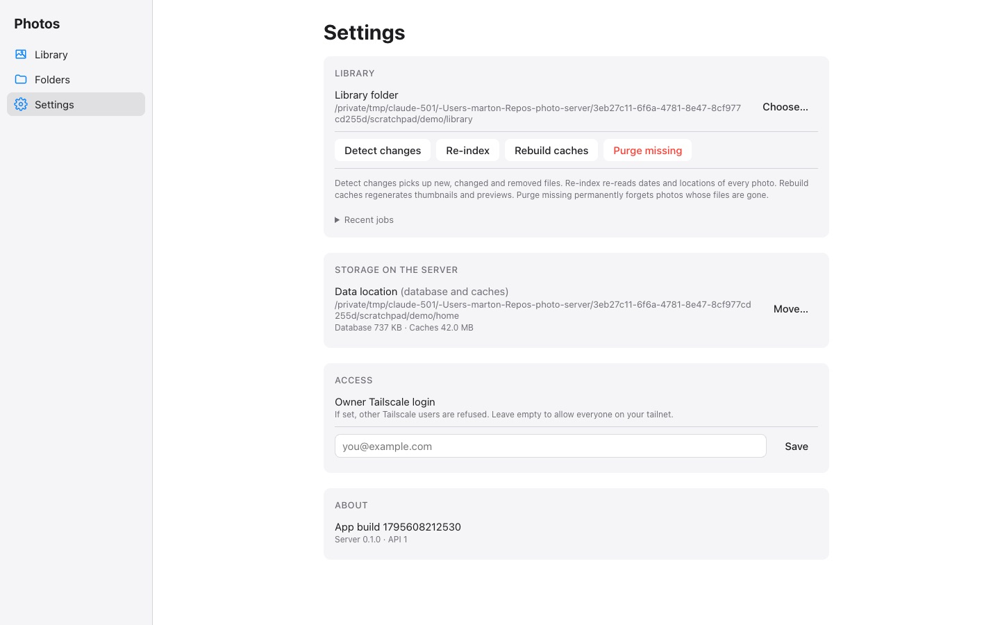

# Web Photo Library

A self-hosted, Apple Photos–style photo library. A Mac serves a **read-only** folder of
images (including Google Photos Takeout exports) to a web app that works on desktop and as an
iPhone Home Screen app, reached privately over [Tailscale](https://tailscale.com).

> Status: **milestone 1 of 6** — indexing, timeline, folders, viewer, settings.
> Albums, offline mode, non-destructive editing, faces and places are designed
> ([spec](docs/superpowers/specs/2026-11-25-photo-server-design.md)) and on the way.

## Screenshots

| Desktop | iPhone |
|---|---|
|  |  |
|  |  |
|  |  |
|  | |

## What it does today

- **Read-only library.** Point it at any folder on the Mac; it never writes there. Thumbnails,
  previews and the database live in a separate, movable data location.
- **Google Takeout aware.** Dates, locations, descriptions and favourites come from Takeout JSON
  sidecars (with all their naming quirks), then EXIF, then the file date. Duplicate copies that
  Takeout scatters across album folders are recognised by content hash and shown once.
- **Fast.** HEIC thumbnails and previews via the Mac's hardware HEVC codec, one decode per photo,
  8 parallel workers (~16 s for 550 photos on an M-series Mac). BlurHash placeholders while loading.
- **Photos-like UI.** Month-grouped timeline (local time where each photo was taken), pinch or
  ⌘-scroll to change density, folders with covers, a full-screen viewer with swipe, swipe-down to
  close, pinch/double-tap zoom, info panel and original download.
- **Everything configured in the browser:** library folder (server-side folder picker), refresh
  jobs (Detect changes, Re-index, Rebuild caches, Purge missing), data location with “Move…”.
- **Versioned API.** Every response carries the API version; if the app and server don't match,
  the app asks you to update (a reload — the server serves the app).

## Requirements

- A Mac with Apple Silicon (macOS 15+), Swift 6 (Xcode or Command Line Tools), Node 20+.
- Tailscale on the Mac and your devices for remote access.

## Run it

```sh
# build the web app
cd web && npm install && npm run build && cd ..

# build and start the server (serves web/build, listens on 127.0.0.1:8787)
cd server && swift build -c release && .build/release/PhotoServer
```

Open <http://127.0.0.1:8787>, choose your library folder in **Settings**, and it starts indexing.
If the folder is in Documents, Desktop or on an external drive, give the server binary (or your
terminal) **Full Disk Access** in System Settings → Privacy & Security.

### From your iPhone (Tailscale)

The server only listens on localhost; Tailscale publishes it inside your tailnet over HTTPS
(needed for the Home Screen app):

```sh
tailscale serve --bg 8787
```

Then open `https://<your-mac>.<your-tailnet>.ts.net` on the phone and use Share → **Add to Home
Screen**. Optionally set your Tailscale login under Settings → Access so only you get in.

## Develop

```sh
scripts/test-server.sh        # server tests (Swift Testing)
cd web && npm test            # web unit tests
cd web && npm run dev         # Vite dev server, proxies /api to 127.0.0.1:8787
PHOTOSERVER_HOME=/tmp/ps2 PORT=8799 server/.build/release/PhotoServer   # second instance, separate data
```

Layout: `server/` (Swift package — `PhotoCore` indexing/DB, `PhotoAPI` HTTP routes, `PhotoServer`
executable), `web/` (SvelteKit single-page app), `docs/` (design spec and plans).
